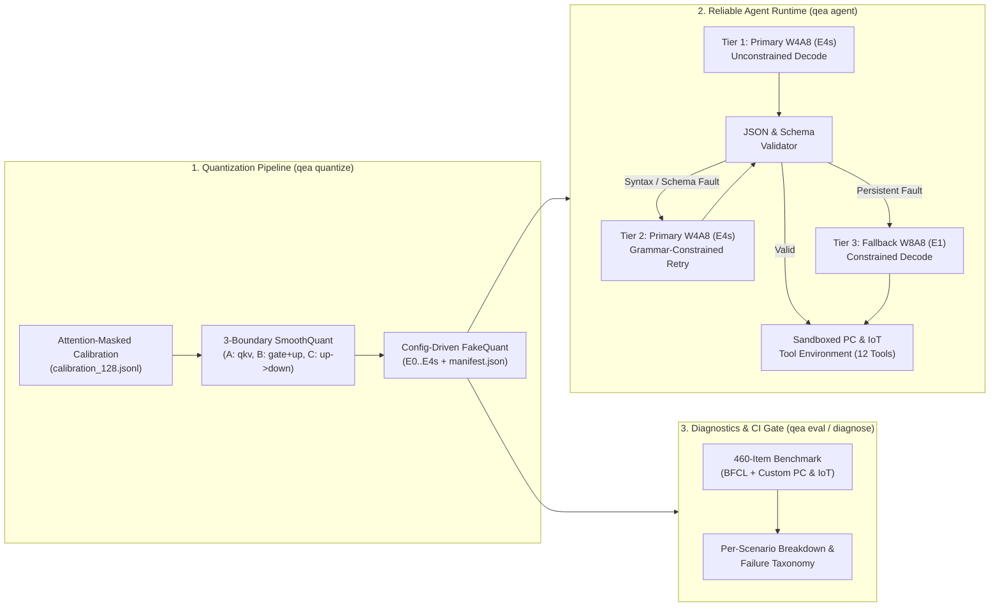
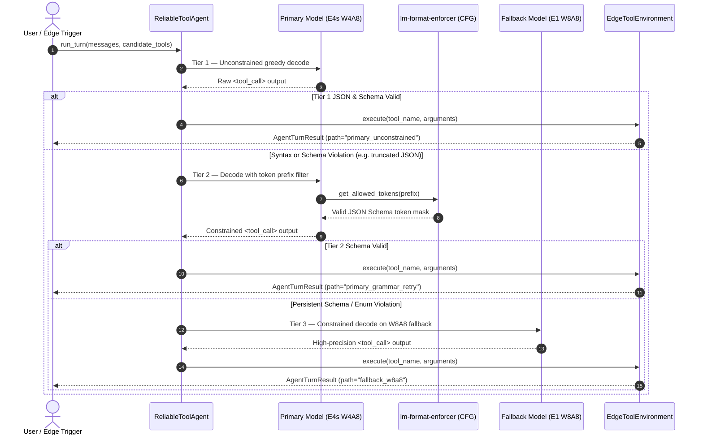
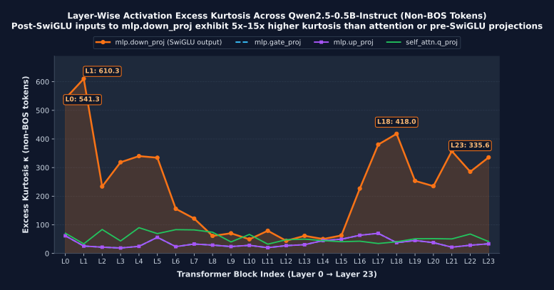
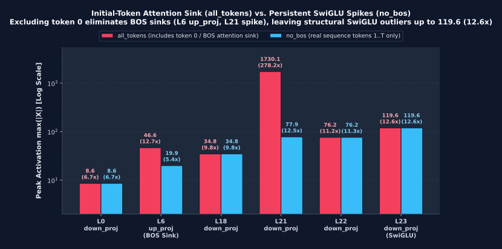
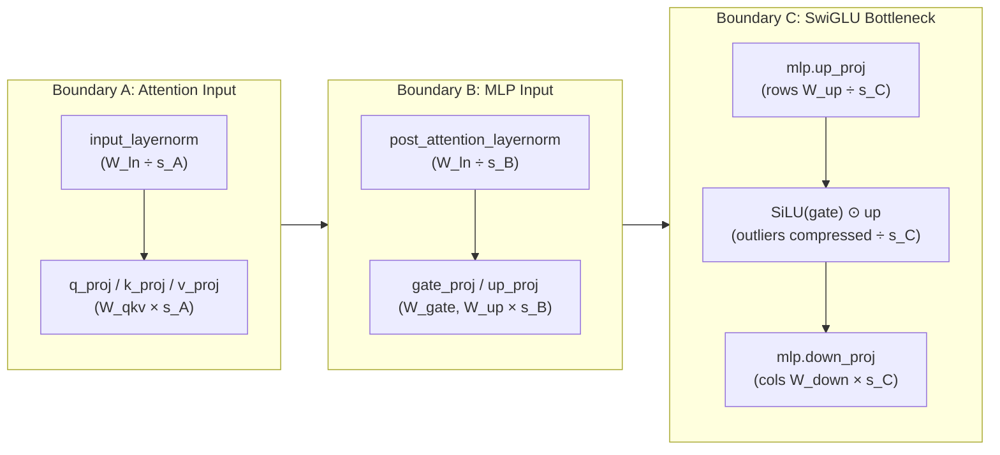
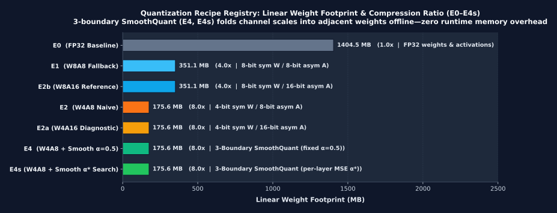
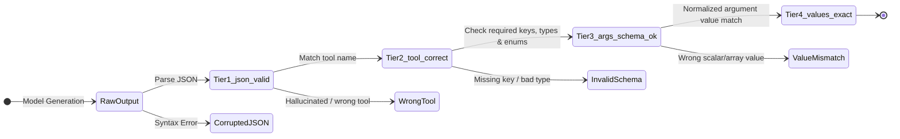
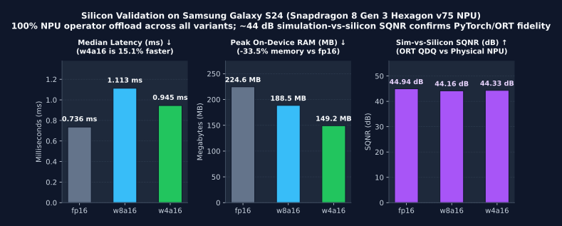

# qnn-edge-agent

[](https://github.com/iamqazolp/qnn-edge-agent/actions/workflows/ci.yml)


**Quantization-aware tool-calling reliability toolkit and sandboxed agent runtime for local PC developer workspaces and IoT edge gateways.**

Sub-1B tool-calling language models (`Qwen/Qwen2.5-0.5B-Instruct`) deployed under integer quantization (`W4A8`, `W4A16`, `W8A8`) exhibit structured failure modes—truncated JSON syntax, enum/type violations, and hallucinated argument values—primarily driven by extreme post-SwiGLU activation outliers entering `mlp.down_proj` (excess kurtosis up to **542.6**).

`qnn-edge-agent` addresses this with a two-part engineering stack:
1. **Quantization & 4-Tier Diagnostic Engine (`qnn_edge_agent.quant`, `qnn_edge_agent.eval`):** Per-channel symmetric `INT4`/`INT8` weights, asymmetric `UINT8`/`UINT16` activations, **3-boundary SmoothQuant** (including SwiGLU `up_proj -> down_proj` scaling with per-boundary MSE $\alpha^*$ search), and a 4-tier tool-call evaluator with Wilson 95% confidence intervals.
2. **Reliable Local PC & IoT Agent Runtime (`qnn_edge_agent.agent`):** 12 deterministic tool executors (6 sandboxed PC developer tools + 6 simulated IoT gateway controllers) guarded by a **3-tier runtime recovery loop** (unconstrained generation $\rightarrow$ grammar-constrained retry via `lm-format-enforcer` $\rightarrow$ `W8A8` fallback).

---

## 1. System Architecture & Runtime Recovery Flow



### 3-Tier Validate $\rightarrow$ Retry $\rightarrow$ Fallback Sequence



---

## 2. Activation Outlier Telemetry & 3-Boundary SmoothQuant

Profiling all 168 linear layers (`24 blocks × 7 projections`) of `Qwen/Qwen2.5-0.5B-Instruct` on tool-calling calibration prompts ([`results/outlier_telemetry.json`](results/outlier_telemetry.json)) reveals why naive `W4A8` (`E2`) degrades structured generation:



### Initial-Token Attention Sink (`all_tokens`) vs. Persistent SwiGLU Spikes (`no_bos`)

A critical diagnostic question is whether these activation spikes are merely initial-token (`BOS`, position `0`) attention sinks or structural channel outliers across the entire sequence:



- **Attention Sink in `mlp.up_proj` (Layer 6):** Removing token 0 (`no_bos`) cuts peak activation magnitude by more than half (`46.6` $\rightarrow$ `19.9`, outlier ratio `12.7x` $\rightarrow$ `5.4x`).
- **Structural SwiGLU Spikes in `mlp.down_proj` (Layers 0, 18, 21–23):** Removing token 0 leaves `mlp.down_proj` kurtosis (`542.6` vs `541.3` in Layer 0) and peak magnitude (`119.6` / `12.6x` in Layer 23) completely unchanged.

### 3-Boundary SmoothQuant Dataflow (`smooth.py`)

To suppress `mlp.down_proj` outliers without adding runtime overhead, [`smooth.py`](src/qnn_edge_agent/quant/smooth.py) implements **3-boundary offline scale migration** ($s_j = \max(|X_j|)^\alpha / \max(|W_j|)^{1-\alpha}$), including per-boundary MSE grid search (`E4s`, $\alpha^* \in \{0.30, 0.40, 0.50, 0.60, 0.70, 0.80, 0.85\}$):



> [!TIP]
> **Why Boundary C (`up_proj -> down_proj`) is mathematically lossless for `up_proj` weights:** Because weight quantization in [`grids.py`](src/qnn_edge_agent/quant/grids.py) is **per-output-channel** (`axis=0`), scaling row $i$ of `up_proj.weight` by $s_{C,i}^{-1}$ scales its quantization step size $\Delta_i$ by the exact same factor—incurring **zero additional weight quantization error** on `up_proj` while shrinking extreme SwiGLU activation spikes before `down_proj`'s 8-bit activation quantizer.

---

## 3. Quantization Recipe Registry & Footprint Compression



| Recipe | Weights | Activations | SmoothQuant | Footprint (Linear) | Role |
|---|---|---|---|---|---|
| `E0` | FP32 | FP32 | `none` | 1404.5 MB (1.0x) | Unquantized baseline |
| `E1` | `W8` sym ch | `A8` asym | `none` | 351.1 MB (4.0x) | 8-bit reference & Tier-3 runtime fallback |
| `E2` | `W4` sym ch | `A8` asym | `none` | 175.6 MB (8.0x) | Naive 4-bit weight / 8-bit activation baseline |
| `E2a` | `W4` sym ch | `A16` asym | `none` | 175.6 MB (8.0x) | Isolates `W4` weight error from `A8` activation error |
| `E2b` | `W8` sym ch | `A16` asym | `none` | 351.1 MB (4.0x) | High-precision 16-bit activation reference |
| `E4` | `W4` sym ch | `A8` asym | `fixed` ($\alpha=0.5$) | 175.6 MB (8.0x) | 3-boundary SmoothQuant with fixed $\alpha=0.5$ |
| `E4s` | `W4` sym ch | `A8` asym | `search` ($\alpha^* \in [0.3, 0.85]$) | 175.6 MB (8.0x) | Per-layer, per-boundary MSE grid search |

---

## 4. 4-Tier Cumulative Evaluation Funnel

Every benchmark item (`460` total: `400` BFCL AST items + `60` custom PC & IoT edge items) is evaluated through a strict 4-stage cumulative funnel in [`tool_call_eval.py`](src/qnn_edge_agent/eval/tool_call_eval.py):



---

## 5. Quickstart & Unified CLI (`qea`)

### Installation

```bash
uv venv --python 3.11 .venv
# Windows (PowerShell)
.\.venv\Scripts\Activate.ps1
# macOS / Linux
# source .venv/bin/activate

uv pip install -r requirements.txt
```

### CLI Commands

```bash
# 1. List all quantization recipes and readiness status
qea recipes

# 2. Calibrate and export a quantized artifact manifest (with calibration SHA-256 & chosen alphas)
qea quantize --recipe E4s --calib-limit 16 --output-dir results/artifacts/E4s

# 3. Run 4-tier evaluation with CI quality-gate assertions
qea eval --recipes E0,E2,E4s --limit 20 --skip-ppl --min-json-valid 0.90

# 4. Generate per-scenario (PC vs IoT vs BFCL) breakdown & failure taxonomy
qea diagnose --results-dir results

# 5. Run the local PC & IoT agent runtime (with deterministic fault-injection demos)
qea agent --item-id iot_eval_00 --offline-demo
qea agent --item-id iot_eval_00 --offline-demo --simulate-fault corrupted_json
qea agent --item-id iot_eval_00 --offline-demo --simulate-fault wrong_schema

# 6. Launch the mobile/web Live Edge Console (open http://<LAN-IP>:8080 on your phone)
qea serve --port 8080
```

---

## 6. Appendix A: Silicon Fidelity Check (Samsung Galaxy S24 Hexagon NPU)

To verify that our PyTorch/ONNX quantization simulation accurately predicts real edge NPU execution, we exported Layer 0 of `Qwen2.5-0.5B-Instruct` (`(1, 128, 896)`) via [`block_export.py`](src/qnn_edge_agent/npu/block_export.py) and [`qdq_insert.py`](src/qnn_edge_agent/npu/qdq_insert.py) and ran on-device profiling and inference on a physical **`Samsung Galaxy S24 (Family)`** (`Snapdragon 8 Gen 3`, `Hexagon v75 NPU`) via Qualcomm AI Hub ([`results/npu_probe/summary.json`](results/npu_probe/summary.json)):



| Variant | Compile / Profile / Inference Jobs | Median Latency | Peak RAM | NPU Offload | On-Device SQNR vs FP32 | Sim-vs-Silicon SQNR (ORT vs NPU) |
|---|---|---|---|---|---|---|
| `fp16` | `jpxrn8d3p` / `jgnqld7kg` / `jp8r0d4kg` | **0.736 ms** | 224.55 MB | **100%** (61/61 ops) | **44.94 dB** | **44.94 dB** |
| `w8a16` | `jp37vlw3g` / `jgowk74qp` / `j5wz20435` | **1.113 ms** | 188.54 MB | **100%** (74/74 ops) | **36.92 dB** | **44.16 dB** |
| `w4a16` | `jgk07w2n5` / `jprd8mx7g` / `j5wz20rm5` | **0.945 ms** | **149.23 MB** | **100%** (74/74 ops) | **12.78 dB** | **44.33 dB** |

> [!IMPORTANT]
> **QNN `INT4` Constant-Folding Discovery (`19.05 ms` $\rightarrow$ `0.945 ms`, 20.1x speedup):** Emitting standalone `INT4` `DequantizeLinear` initializers in ONNX opset 21 caused `qnn-onnx-converter` to promote the 7 linear weight tensors to external runtime graph inputs (`19.05 ms` latency). Rewriting weights as grid-aligned `FP32 initializer -> QuantizeLinear(axis=1) -> DequantizeLinear(axis=1) -> MatMul` in [`qdq_insert.py`](src/qnn_edge_agent/npu/qdq_insert.py) enabled `qnn-onnx-converter` constant folding into `qnn_dlc`, achieving **0.945 ms** (**15.1% faster than `w8a16`**) and **149.23 MB peak RAM** (**-33.5% vs `fp16`**).

---

## 7. Testing & Reproducing Visual Assets

```bash
# Run all 61 unit tests
pytest

# Run linter
uvx ruff@0.17.2 check .

# Regenerate SVG charts in docs/assets/ from results/ telemetry
python scripts/generate_readme_charts.py
```
